<a href="https://felixs.dev">
  <picture>
    <source media="(prefers-color-scheme: dark)" srcset="https://raw.githubusercontent.com/trueberryless/trueberryless/output/profile-dark.svg">
    <source media="(prefers-color-scheme: light)" srcset="https://raw.githubusercontent.com/trueberryless/trueberryless/output/profile-light.svg">
    
  </picture>
</a>
